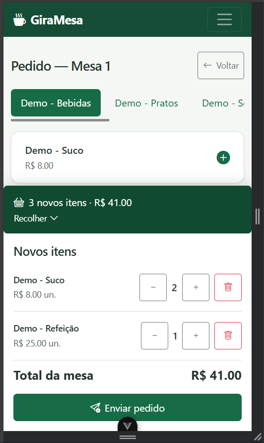

# GiraMesa

O GiraMesa foi desenvolvido em 2026 como projeto do curso de Análise e Desenvolvimento de Sistemas da UniSENAI, em Joinville (SC). A proposta é reunir o consumo de cada mesa e a conferência da conta em um só fluxo, do pedido lançado pelo garçom no celular à quitação no caixa.

[Vídeo de demonstração](<docs/apresentacao/GiraMesa - Demonstração.mp4>) · [Relatório técnico](<docs/abnt/Documentação GiraMesa - Versão final.pdf>) · [Instalação](docs/instalacao.md) · [Testes](docs/TESTES.md)

## Como o sistema funciona

| Perfil | Atividades |
| --- | --- |
| Garçom | Consulta o salão, monta o pedido no celular e envia o consumo para a mesa. |
| Caixa | Confere o consumo, divide a conta, registra pagamentos parciais e libera a mesa na quitação. |
| Administrador | Gerencia usuários, mesas, categorias e produtos. Acompanha vendas, ticket médio e formas de pagamento no dashboard. |

## Decisões

- **Divisão em centavos.** Uma conta de R$ 100,00 dividida entre três pessoas pode ser quitada com R$ 33,33, R$ 33,33 e R$ 33,34. A última parcela cobre o saldo exato. A API registra o pagamento e conclui o pedido na mesma transação que libera a mesa. [Evidência da última parcela](docs/telas/capturas/figura23-teste-ultima-parcela.jpg)
- **Histórico de vendas.** Cada item guarda o nome e o preço unitário praticados na venda. Um reajuste no cardápio preserva o valor cobrado nos pedidos anteriores. [Modelo do item](backend/src/models/ItemPedido.js)
- **Indicadores a partir de pedidos quitados.** O dashboard agrega as vendas finalizadas pela data de fechamento. Os testes conferem que o faturamento só muda após a quitação. [Contrato do dashboard](docs/api/dashboard.md)

## Lições aprendidas

- **Revisar antes de integrar.** No início, os commits iam direto para a `main`. Por orientação do professor, o trabalho passou para a `develop`, com commits pequenos e mensagens padronizadas. A integração passou a ocorrer por Pull Request, com as mudanças disponíveis para revisão. [Primeiro PR](https://github.com/lucas-travassos/giramesa/pull/1)
- **Checar o ambiente primeiro.** O erro de CORS no login vinha de uma requisição enviada à API de outro projeto na porta 3000. A porta 3001 passou a ser o padrão configurável do GiraMesa, e a conferência de portas entrou no roteiro de diagnóstico.
- **Revisar o modelo ao validar as telas.** O protótipo mostrou a necessidade de editar categorias e registrar pagamentos parciais. Essas necessidades chegaram ao banco e ao diagrama como entidades próprias.
- **Isolar os dados de teste.** Inativar a conta administrativa de demonstração durante um teste bloqueou o acesso. O sistema passou a proteger o último administrador ativo, e os testes destrutivos passaram a usar registros novos ou bancos descartáveis.
- **Manter o contexto junto do código.** O `AGENTS.md` guarda as regras do projeto, o `STATUS.md` registra o estado atual e o Git preserva o histórico. Isso ajudou a retomar o trabalho após a troca de ferramenta.

## Arquitetura

A interface usa JavaScript, Vue 3 e Bootstrap, com Pinia para o estado e Vue Router para a navegação por perfil. A API em Node.js, Express e Sequelize valida as permissões e aplica as regras de negócio. O MySQL 8.4 roda com Docker Compose. Consultas SQL agregam os dados para o dashboard. [Diagrama do banco](docs/diagramas/der-giramesa.png) · [Documentação técnica](docs/README.md)

## Executar e testar

1. Siga o [guia de instalação](docs/instalacao.md) para configurar o MySQL, aplicar as migrations e preparar os dados fictícios.
2. Inicie `npm run dev` em `backend/` para a API na porta 3001. Em outro terminal, rode `npm run dev` na raiz e abra [localhost:5173](http://localhost:5173).
3. Use as contas do guia. Como garçom, envie um pedido em uma mesa disponível. Como caixa, registre uma parte do pagamento e confira a liberação da mesa após quitar o saldo.

Com o Docker ativo, execute `npm test` em `backend/` para rodar a suíte com MySQL e API temporários. O Quadro 1 do relatório documenta dez cenários com evidências de interface e API. Os resultados e os limites de cada verificação estão na [matriz de testes](docs/TESTES.md).

## Uso de IA no projeto

A IA apoiou o planejamento, a implementação e a revisão da documentação. As regras de negócio e o aceite das etapas ficaram sob responsabilidade do autor. Um exemplo é o fechamento de mesa, cuja regra de quitação foi conferida com testes automatizados e registros da execução pela interface. Os resultados constam na matriz de testes. O [histórico de commits](https://github.com/lucas-travassos/giramesa/commits/develop/) registra a evolução do projeto desde a primeira versão.
